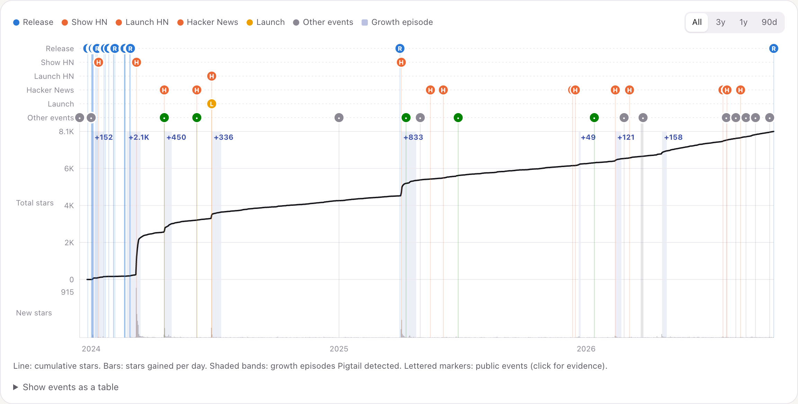
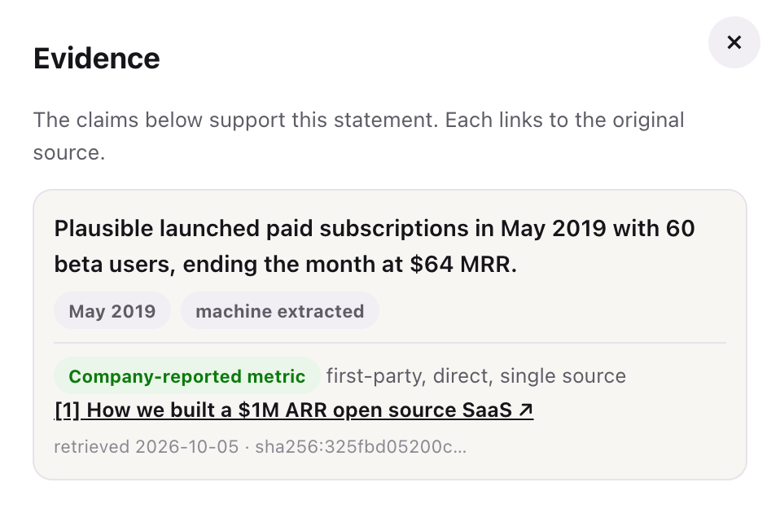
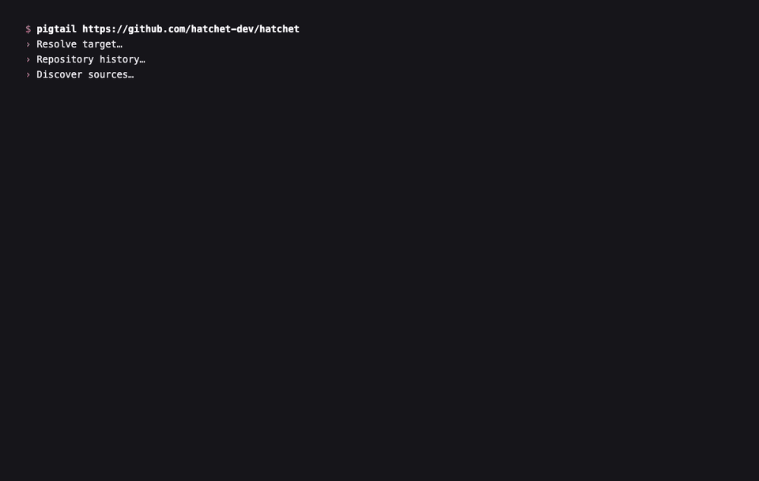

<h1 align="center">pigtail<span>.</span></h1>

<p align="center">
  <strong>Reverse-engineer how open-source projects and products grew.</strong>
</p>

<p align="center">
  Why did this repo suddenly gain 4,000 stars?<br>
  What did they ship? Where did they launch? What happened after each launch?
</p>

<p align="center">
  <a href="https://suchipizza.github.io/pigtail/">Website</a> ·
  <a href="https://suchipizza.github.io/pigtail/examples/">Example reports</a> ·
  <a href="docs/quickstart.md">5-minute quick start</a> ·
  <a href="docs/methodology.md">Methodology</a> ·
  <a href="docs/">Docs</a> ·
  <a href="https://suchipizza.github.io/pigtail/legal/">Legal &amp; privacy</a>
</p>

Give Pigtail a public GitHub repository:

```bash
pigtail https://github.com/plausible/analytics
```

Pigtail reconstructs the project's public growth history. It finds the launches, posts and releases
around each big jump in stars, and puts them on the **same timeline as the GitHub star history**:



It does **not** pretend that a nearby event caused a jump. If Pigtail finds a Show HN post, a
release, a blog post or another public event near a growth episode, it shows that they happened at
the same time and links you to the evidence. If it cannot find a defensible explanation, it says so:

> **No high-confidence public event found.**

Every fact in the report can be checked. Click it to see the source, the date it covers, what kind
of evidence it is and when Pigtail read it:

<p align="center"></p>

**See finished reports without installing anything:** [Hatchet](https://suchipizza.github.io/pigtail/examples/hatchet/),
[PocketBase](https://suchipizza.github.io/pigtail/examples/pocketbase/),
[Plausible](https://suchipizza.github.io/pigtail/examples/plausible/) and
[more examples](#example-reports).

## See it in 20 seconds



```text
repository URL
→ reconstruct the star history
→ find launches, releases and public posts
→ detect the big growth episodes
→ compare repeated launches
→ show what happened afterwards
→ open the evidence behind every claim
```

Pigtail is for **open-source maintainers, developer-tool founders, growth people and researchers**
who want to know how a project actually grew, instead of relying on generic growth advice or an
unsourced AI summary.

---

## Try it

### Install

Python 3.12 or newer. Using [`uv`](https://docs.astral.sh/uv/):

```bash
uv tool install git+https://github.com/suchipizza/pigtail
```

Or `pipx install git+https://github.com/suchipizza/pigtail`, or `pip install` it inside a virtual
environment.

### Add your API key

```bash
export ANTHROPIC_API_KEY="sk-ant-..."   # required: Pigtail uses Claude to search the web and read sources
export GITHUB_TOKEN="ghp_..."           # optional: raises GitHub's limit from 60 to 5,000 requests/hour
```

Pigtail runs on your computer. There is **no Pigtail account**, database, Docker setup or hosted
service. Pigtail itself is free; you pay Anthropic for the tokens a run uses.

Check your setup (free):

```bash
pigtail doctor
```

### Run your first report

```bash
pigtail https://github.com/plausible/analytics    # an open-source project
pigtail tally.so                                  # a product website
```

A run takes **2–6 minutes**. With Claude Opus 5.5, it cost **$1–3 per repository** and **$2–5 per
product website**, measured on 10 targets ([validation report](validation/2026-10-06/REPORT.md)).
The default model, Claude Sonnet 5.5, costs half as much per token, so expect roughly half that
(not measured systematically yet). `run.json` records what each run cost. When the run finishes,
the report opens in your browser.

Full setup guide: [5-minute quick start](docs/quickstart.md).

---

## What Pigtail shows you

For an open-source repository, where the evidence exists:

- **GitHub star history**, with launches, posts and releases on the same timeline
- **growth episodes**: unusual jumps in stars, and what was happening at the time
- **Show HN and Hacker News** posts, releases and other launches
- **launches compared**: stars the day before, then +24h, +7 days, +30 days and +90 days
- **what the project looked like before each launch**
- **origin and first users**: who they were and how they were reached
- **growth tactics**, **growth engines** (what kept bringing users) and **strategy changes**
- **metrics** as reported, with conflicting numbers side by side
- **research gaps**: jumps nobody explained publicly, and what could not be established
- **every source**, linked

So you can ask:

- Why did this repository suddenly start growing?
- What happened around its biggest jumps in stars?
- Did the Show HN post line up with real growth?
- Did later launches do better than earlier ones? What changed between them?
- Did growth continue after the launch, or fall back?
- Which jumps have a public explanation, and which are still unknown?

Pigtail keeps one distinction throughout:

```text
an event happened near a jump in stars
≠
the event caused the jump
```

---

## Not just GitHub repositories

Open-source growth is where Pigtail is strongest, but you can also give it a product website:

```bash
pigtail tally.so
```

Pigtail then reads founders' posts, company blogs, interviews, articles and launch history, and
reconstructs how the product grew. Where the evidence exists, the report covers:

- origin and first users
- a growth timeline: launches, campaigns, pricing changes, partnerships
- historical metrics (users, revenue) as reported
- growth engines, reusable tactics and strategy changes
- failures, reversals and constraints
- key takeaways
- evidence and research gaps

Pass a domain (`notion.so`) or a GitHub URL, not a bare name (`"Notion"`): names are ambiguous.

The goal is not a generic company summary. It is **what happened, when, what changed, what the
evidence says, and what is still unknown**.

---

## Why Pigtail exists

Growth advice tells you **what people say works**.
Star-history charts tell you **that a repository moved**.
A chatbot gives you a plausible story about **why it moved**.

Pigtail answers a different question:

> **What can we actually reconstruct from the evidence?**

For an open-source project, that means going from *"this repo grew fast"* to:

```text
here is when it grew,
here are the public events around those moments,
here is what the project had shipped,
here is what happened after each launch,
and here is the evidence for every claim.
```

That is useful whether you study your own repository, a competitor, or a project whose distribution
you want to understand.

---

## Example reports

Read them on the [Pigtail website](https://suchipizza.github.io/pigtail/examples/), or download a
folder from [`examples/reviewed/`](examples/reviewed) and open its `report.html` in a browser. No
installation needed.

| Example | Why it is useful |
|---|---|
| [Hatchet](https://suchipizza.github.io/pigtail/examples/hatchet/) | Open-source task queue with repeated Hacker News launches (Show HN ×3, Launch HN), compared side by side |
| [PocketBase](https://suchipizza.github.io/pigtail/examples/pocketbase/) | One-developer open-source backend; growth in bursts, several with no public explanation |
| [Plausible Analytics](https://suchipizza.github.io/pigtail/examples/plausible/) | Open-source analytics grown by opinionated blog posts that reached Hacker News; bootstrapped revenue history |
| [Agent-Reach](https://suchipizza.github.io/pigtail/examples/agent-reach/) | A free CLI for AI agents: about 95,000 stars in under eight months, in bursts that lined up with GitHub Trending runs |
| [Tally](https://suchipizza.github.io/pigtail/examples/tally/) | Bootstrapped form builder: cold outreach → free-product loop → search and AI discovery, with MRR history |
| [Superhuman](https://suchipizza.github.io/pigtail/examples/superhuman/) | Paid email app: waitlist, concierge onboarding, product-market-fit survey; later acquired and renamed by Grammarly |

Re-render an example without API keys or network access:

```bash
pigtail render examples/reviewed/hatchet/public-report-bundle.json
```

Every published example went through Pigtail's [publication gate](docs/publication-gate.md): names
and account handles are replaced by roles, personal financial details and unreviewed sensitive
claims are removed, excerpts are capped at 15 words, and internal run data (model, cost, IDs) is
left out. The review decisions were made by an AI on the maintainer's behalf; a human review is
pending. Reports you generate yourself are not changed by any of this.

---

## What you get

Each run writes a folder such as:

```text
pigtail-output/plausible-1a2b3c4d/
├── report.html
├── research-bundle.json
├── source-index.json
└── run.json
```

| File | What it is |
|---|---|
| `report.html` | The growth report. One file; opens offline in any browser; easy to share. |
| `research-bundle.json` | Everything Pigtail found as structured data: sources, claims, events, metrics, tactics, gaps. |
| `source-index.json` | A plain list of the sources used. |
| `run.json` | How long the run took, what it cost, how many requests it made. |

The report is drawn entirely from the Research Bundle, so the research can be inspected instead of
being trapped in generated prose.

---

## How Pigtail stays honest

Pigtail uses a language model to read sources, but the rules that matter are enforced in code.

- **Every fact has a source.** Each statement in the report is a *claim* that traces back to its
  evidence: claim → source → when Pigtail read it → quote or data location.
- **Quotes are checked.** A claim whose quote cannot be found word for word in the page is dropped.
  Numbers must appear in the cited claims; dates must match them.
- **Timing is not cause.** If a Show HN post and a jump in stars happen the same week, the report
  says they were *observed near the same period*. It says one caused the other only when the
  company itself says so in a cited source.
- **Conflicts stay visible.** When sources disagree, you see both numbers, not an average.
- **Unknown is an answer.** A jump with no public explanation is shown as *"No high-confidence
  public event found."* If there is too little evidence overall, the report says *"Insufficient
  public evidence for a useful Pigtail forensic."* instead of filling the page.
- **Not an archive.** Pigtail keeps links, metadata and short quotes, never copies of pages. Each
  platform's rules are written down in [`source-policies/`](source-policies).

More in [methodology](docs/methodology.md), [evidence model](docs/evidence.md) and
[source policies](docs/source-policies.md).

---

## Validation

Pigtail was run on a separate, non-curated set of 10 targets: large and small repositories,
launch-heavy and organic projects, an archived project and non-open-source products. The checks
cover source correctness, whether each citation supports its claim, dates, entity mix-ups,
invented sources, unsupported causal claims, runtime, cost, and behaviour on sparse or ambiguous
targets.

See the [validation report](validation/2026-10-06/REPORT.md), including the failures found and the
general fixes made from them.

---

## Sources

Pigtail reads directly from:

- **GitHub**: repository, star history, releases, README
- **Hacker News**, through HN Search by Algolia
- **public web pages** whose `robots.txt` allows it
- **Anthropic's web search**, to discover sources (same API key)

It never reads Reddit, Product Hunt or X web pages. Launches there appear when another source, such
as the maker's blog, mentions them, or as links found by web search. Two optional extras, with your
own keys, add more:

### Reddit (optional)

Reddit is where many projects are first shared, but the web search Pigtail uses returns few Reddit
pages, so by default the report notes that Reddit coverage is incomplete.

**Posts you already know about** can be added by hand. Put them in a text file, one per line:

```text
# link | date (YYYY-MM-DD) | title
https://www.reddit.com/r/SideProject/comments/1abc23/my_post/ | 2026-04-06 | My side project crossed 1,000 stars
```

```bash
pigtail <target> --reddit-links reddit-posts.txt
```

Each post goes on the timeline with its title and date, marked as listed by hand. Pigtail never
opens the post.

**If you already have Reddit API access**, Pigtail can also search Reddit through its official API
with your own app keys. It finds posts that link to or mention the repository (or the product's
domain), plus the same people's other posts that name the project. It keeps only each post's title,
link, subreddit, date, upvotes and comment count, never the post text or usernames (usernames are
used only during the search).

New Reddit API access needs Reddit's approval. Its
[Responsible Builder Policy](https://support.reddithelp.com/hc/en-us/articles/42728983564564-Responsible-Builder-Policy)
says you "must request access and get explicit approval before accessing any Reddit data through our
API", so creating an app at <https://www.reddit.com/prefs/apps> is not enough on its own. Pigtail
works fully without it. If you have approved keys:

```bash
export REDDIT_CLIENT_ID="..."      # the short string under your app's name
export REDDIT_CLIENT_SECRET="..."
pigtail doctor                     # the "Reddit API" line should say OK
```

`pigtail <target> --no-reddit` skips the Reddit API for one run.

### Product Hunt (optional)

With **your own free Product Hunt developer token**, Pigtail also asks Product Hunt's official API
for the product's launches and adds each one to the timeline with its exact date, upvotes and
comment count.

The API cannot search by name, so Pigtail looks for Product Hunt links on the product's homepage and
README (a "Featured on Product Hunt" badge), in web-search results, and tries addresses made from the
product's name. Many products share a name, so a launch found that way is kept only if its name
contains the product's name and it is not older than the project. A launch can still be missed, for
example a first launch under another name. Pigtail keeps only each launch's name, date, upvotes,
comment count and link.

1. Sign in at <https://www.producthunt.com/v2/oauth/applications> and click **Add an application**
   (any name; `https://localhost` as the redirect URI).
2. On the application's page, click **Create Token** and copy the **developer token**:

```bash
export PRODUCTHUNT_TOKEN="..."
pigtail doctor                     # the "Product Hunt API" line should say OK
```

`pigtail <target> --no-producthunt` skips it for one run.

> **Your responsibility.** Optional data sources use your own keys, and their terms apply to you:
> Reddit's [Data API Terms](https://redditinc.com/policies/data-api-terms) and Product Hunt's
> [API terms](https://api.producthunt.com/v2/docs) both restrict commercial use. The data stays on
> your computer; Pigtail's maintainers never receive it.

Reports on the Pigtail website never include Reddit or Product Hunt API data; Reddit posts there are
links found by web search or listed by hand.

---

## Choosing a Claude model

Pigtail uses **Claude Sonnet 5.5** unless you choose another model with `--model`:

```bash
pigtail tally.so --model opus              # a short name…
pigtail tally.so --model claude-opus-5-5   # …or a full Claude model ID
pigtail models                             # list the choices
pigtail doctor --model opus                # check the model works with your key (free)
```

| `--model` | Model | $ per 1M tokens (in / out) | Notes |
|---|---|---|---|
| `sonnet` (default) | Claude Sonnet 5.5 (`claude-sonnet-5-5`) | $2 / $10 | Balanced cost and quality. |
| `opus` | Claude Opus 5.5 (`claude-opus-5-5`) | $4 / $20 | About twice the cost. Measured $1–3 per repository, $2–5 per product website. |
| `haiku` | Claude Haiku 4.5 (`claude-haiku-4-5`) | $1 / $5 | Cheapest. Not tested with Pigtail yet; reports may be thinner. |
| `fable` | Claude Fable 5.1 (`claude-fable-5-1`) | $10 / $50 | Most capable, about 5x the default cost. Not tested with Pigtail yet. |

Any other Claude model ID (`claude-…`) is accepted too, and you can set the model in `pigtail.toml`
(`[model] model = "opus"`, see [troubleshooting](docs/troubleshooting.md#configuration-file)).
Pigtail never switches models silently: each run starts by printing the model it uses.

---

## How Pigtail compares

**Star-history charts** (e.g. star-history.com) show *when* stars increased. Pigtail adds what was
around them:

```text
star curve + launches + releases + public posts + after-launch windows + evidence + the wider story
```

**Asking a chatbot "how did X grow?"** gives fluent prose you cannot check. Pigtail gives a research
file in which every claim links to its evidence, conflicts stay visible and unknowns stay unknown.

**Doing it by hand** means hours of searching GitHub, Hacker News, founders' blogs, interviews and
launch posts. Pigtail does most of that in minutes and leaves you a report and a structured file you
can check and share.

---

## More commands

```bash
pigtail analyze <target>                          # same as `pigtail <target>`
pigtail <target> --model opus                     # choose the Claude model
pigtail models                                    # list the models you can choose
pigtail <target> --output ./reports
pigtail <target> --source https://example.com/launch-post   # add a source you know (checked like any other)
pigtail <target> --reddit-links posts.txt         # add Reddit posts you know about (link | date | title)
pigtail <target> --no-reddit                      # skip the Reddit API even if your keys are set
pigtail <target> --no-producthunt                 # skip Product Hunt even if your token is set
pigtail render research-bundle.json               # rebuild report.html, no keys or network needed
pigtail validate research-bundle.json             # check a bundle against the schema and integrity rules
pigtail doctor
pigtail version
```

A source you add with `--source` is evidence to check, not something taken as true.
Configuration (`pigtail.toml`), exit codes and common errors:
[docs/troubleshooting.md](docs/troubleshooting.md).

---

## Supported environments

- Python 3.12 or newer
- tested on macOS, and on Linux in CI; Windows should work but is not tested yet
- model: Anthropic Claude (default `claude-sonnet-5-5`)
- optional: a GitHub token for higher API limits; your own Reddit or Product Hunt keys

---

## Known limitations

- Quality depends on what is public. Well-documented projects give rich reports; quiet ones give
  short reports with many gaps, by design.
- Pigtail knows nothing that is not public: private metrics, internal experiments and unannounced
  decisions are invisible to it.
- Company-reported numbers are shown as reported, not audited.
- Hacker News posts are matched by the project's URL and name, so some are missed.
- Reddit coverage is incomplete without your own approved API keys.
- Star history counts current stargazers by the day they starred; people who later un-starred are
  not counted.
- Some websites block automated reading; they appear as research gaps.
- Machine extraction can still misread a source. Every claim links to its source so you can check.
- Pigtail does not prove causes from timing, and will not explain every jump in stars.

---

## Architecture

```text
target → resolve → GitHub history → discover sources → fetch → extract claims (quote-checked)
       → reconstruct timeline → detect growth episodes → analyze tactics and growth engines
       → keep conflicts and gaps → Research Bundle → report.html
```

The report is rendered only from the Research Bundle, a versioned JSON format. See
[architecture](docs/architecture.md), [Research Bundle format](docs/research-bundle.md) and the
[JSON schema](schemas/research-bundle/0.1.0.schema.json).

---

## Roadmap

Near term:

- package-download history (npm, PyPI)
- incremental `pigtail update` of an existing Research Bundle
- more reviewed examples

Later: reviewed Research Bundles could form a cross-project dataset for studying which growth
tactics seem to work, under which conditions, and where the counterexamples are.

---

## Contributing

Bug reports, wrong-claim reports and pull requests are welcome. Start with
[CONTRIBUTING.md](CONTRIBUTING.md). Good areas to help: source discovery and parsing, growth-episode
detection, report wording, test fixtures, documentation and source policies.

Found a claim its cited source does not support?
[Open a "wrong claim" issue](https://github.com/suchipizza/pigtail/issues/new?template=bad-claim.yml).

Security issues: see [SECURITY.md](SECURITY.md).

---

## License

MIT — see [LICENSE](LICENSE). Maintained by [@suchipizza](https://github.com/suchipizza).
Example reports, privacy and optional data sources: [Legal & privacy](https://suchipizza.github.io/pigtail/legal/).
Corrections or removal requests: rakotomalala.noemie@gmail.com or a GitHub issue.
